<div align="center">

# Verb 'em all

**Gotta catch 'em all, but for Claude's fancy verbs.**
A desktop app with a pet that feeds on the weird verbs Claude Code mutters while it works.


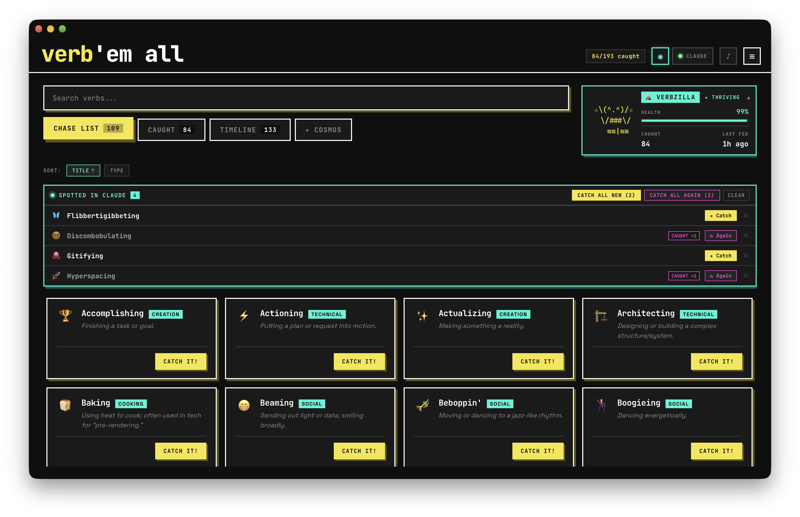

</div>

You ask Claude Code to fix a typo and it spends eight seconds *Flibbertigibbeting*. Then
*Discombobulating*. Then *Razzle-dazzling*. This app exists because someone thought that
deserved a Pokédex, and nobody stopped them.

## 🎮 How it works

1. **🔍 Chase.** Browse 193 hand-picked, slightly unhinged and definitely weird verbs.
2. **⚡ Catch.** Met one in the wild? Catch it, add a note about where were you when you got it. Was it a bug? Was it a new feature? Was it while contemplating life choices?
3. **🤖 Or let it catch itself.** Turn on monitoring and verbs from your Claude Code sessions
   (spinner included) pop up for one-click catching. Booooring, so do it yourself and check the app all the time.
4. **🐣 Feed the Verbagotchi.** An ASCII creature lives on your catches. Ignore it for a week
   and it runs away with one of your verbs. It's not mad, just disappointed. Let's resolve these commitment issues you have been having.

## 📸 The tour

<table>
  <tr>
    <td width="50%">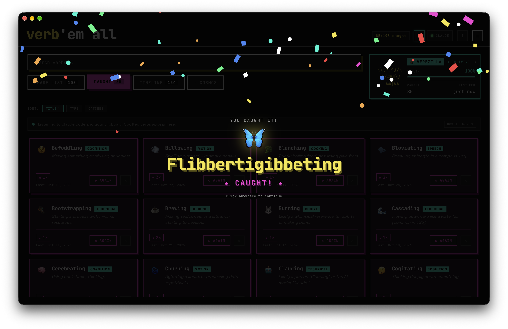<br><b>Every catch gets confetti.</b> We have to party like c-r-a-z-y sometimes, right?</td>
    <td width="50%">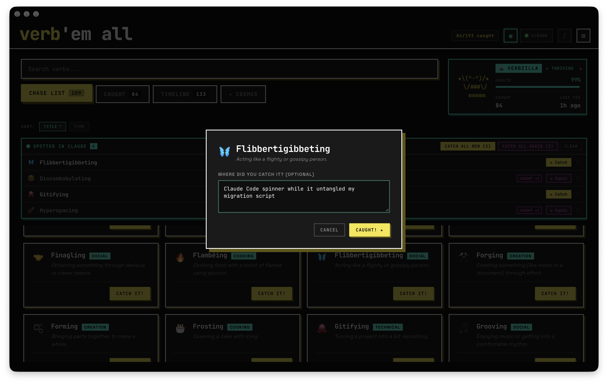<br><b>Leave a note</b> so future you remembers where it came from.</td>
  </tr>
  <tr>
    <td>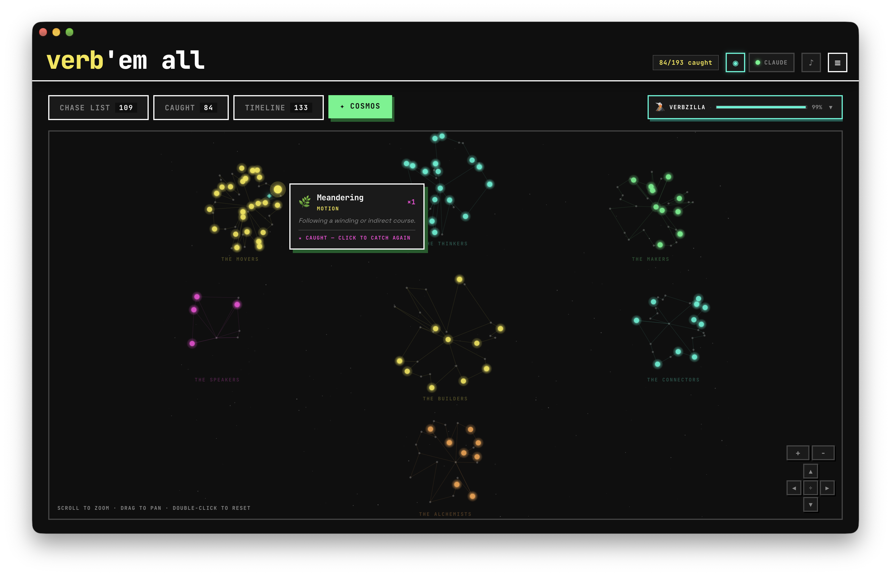<br><b>Cosmos:</b> every verb is a star. Just like you <3. The caught ones shine and yes, they make sounds.</td>
    <td>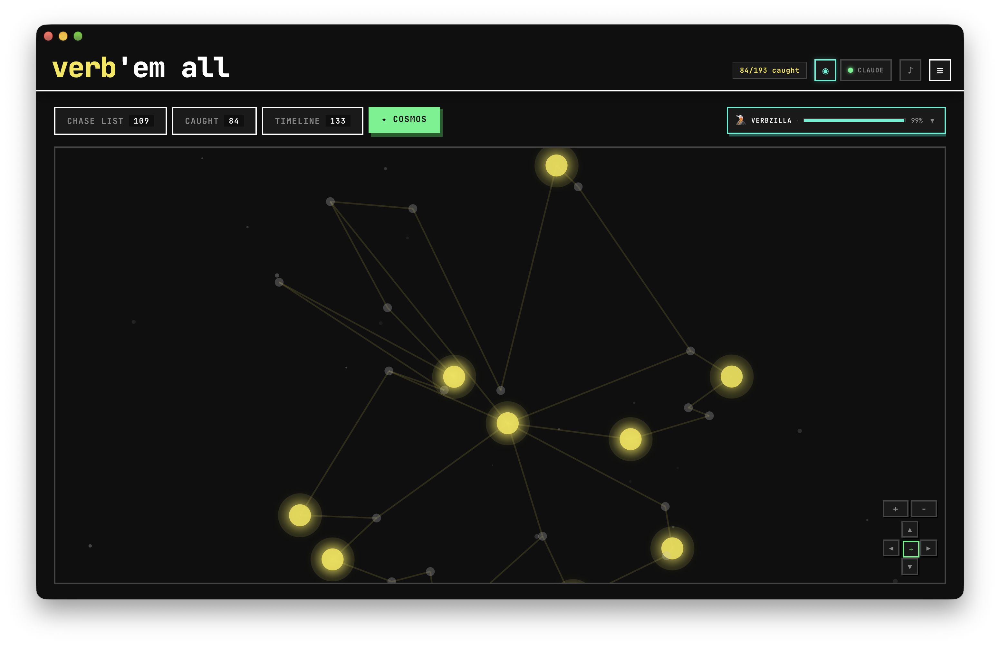<br><b>Zoom in</b> and the creature is out there, roaming between your catches.</td>
  </tr>
  <tr>
    <td>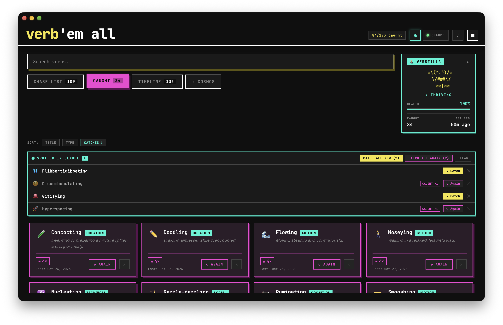<br><b>Your collection</b>, sorted by how often a verb keeps showing up.</td>
    <td>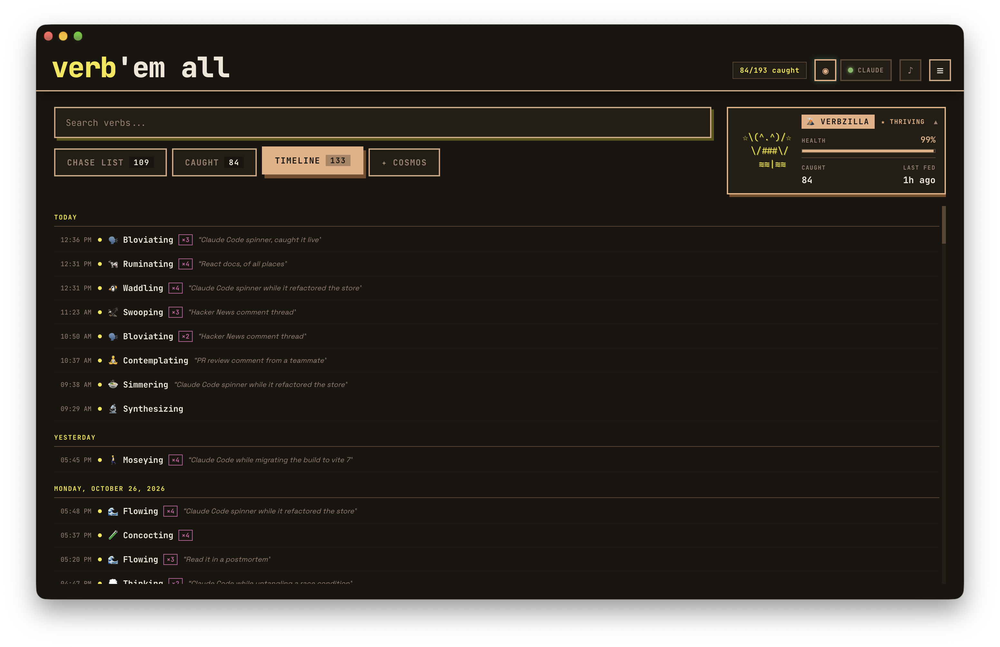<br><b>Timeline:</b> a diary of every catch. Look, I even have multiple themes to use at the app! All coded by Claude of course.</td>
  </tr>
  <tr>
    <td>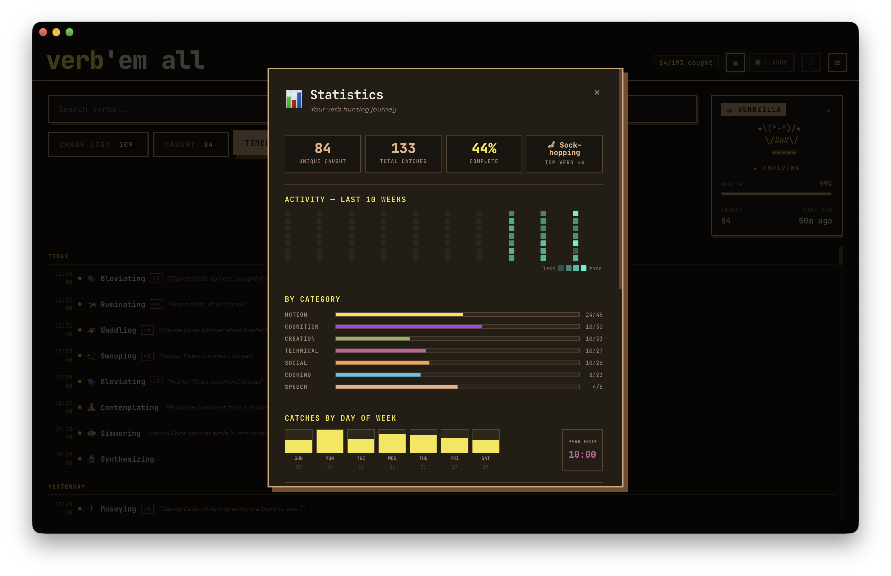<br><b>Statistics</b> so you can prove this is a productive use of your time and because what is a vibe-coded app without statistics and achievements?</td>
    <td>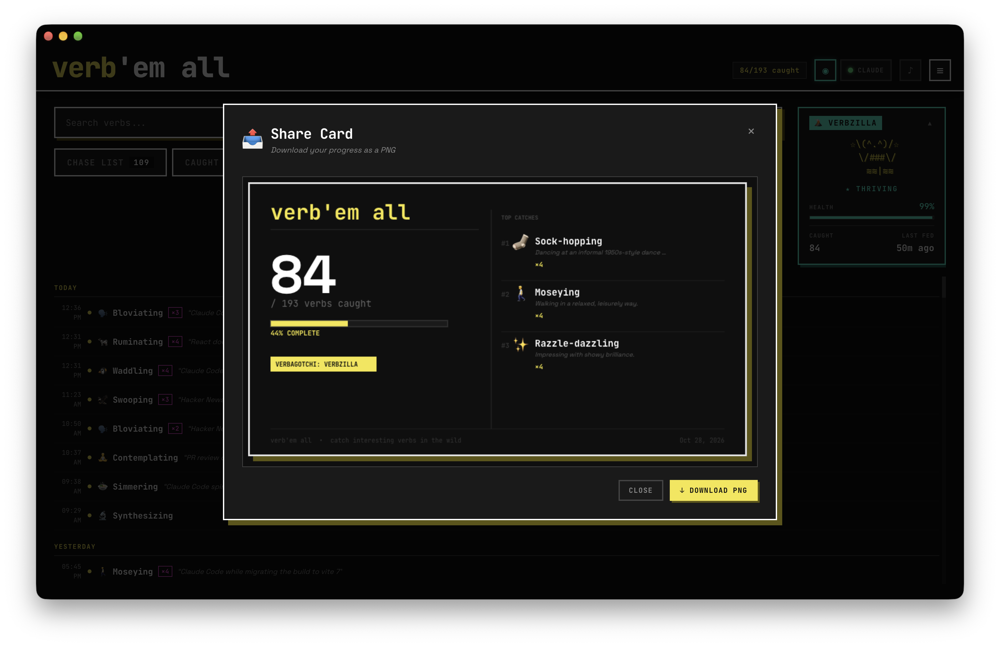<br><b>Share card:</b> a PNG for LinkedIn, so everyone knows. I know you have no life, so prove it with a share on Linkedin.</td>
  </tr>
  <tr>
    <td>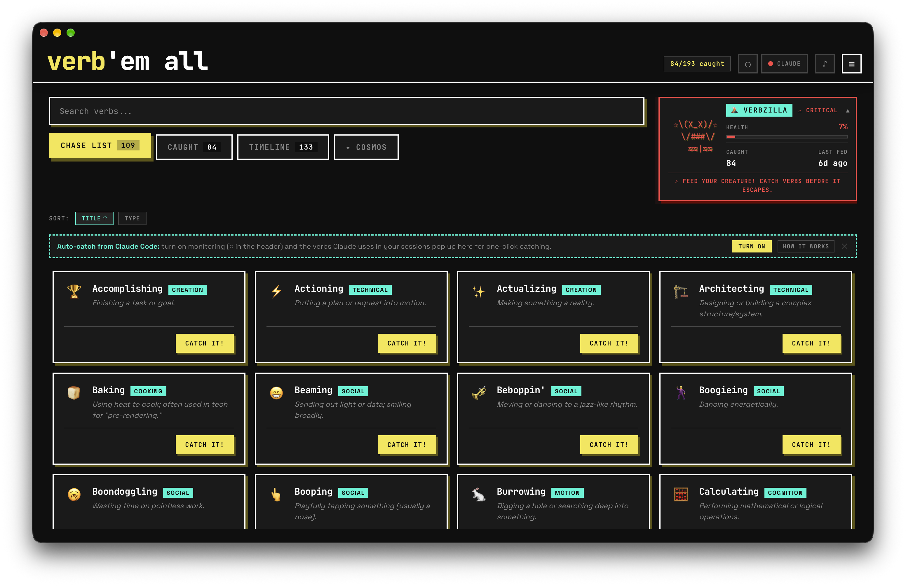<br><b>Neglect it</b> and the Verbagotchi turns red. Then it leaves. Life sucks, deal with it.</td>
    <td>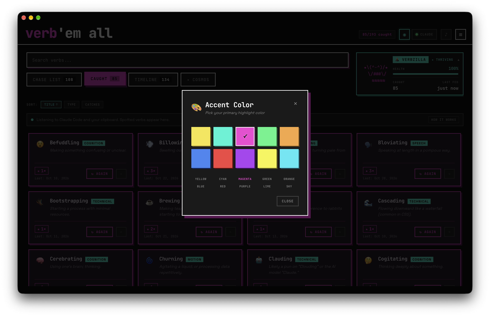<br><b>Ten accent colours</b>, because neo-brutalism still deserves options.</td>
  </tr>
</table>

## ✨ Also in the box

- 🌌 **7 constellations:** the Movers, Thinkers, Makers, Builders, Speakers, Connectors and Alchemists. All proudly generated by AI and its "eternal" wisdom and "creativity".
- 🐣 **4 evolutions:** Hatchling → Verblet → Verbion → Verbzilla. Rooooooar!
- 🎵 **Procedural sound:** every verb has its own little catch spell. See how creative I can be?
- 🍔 **Menu bar mode:** quick-catch from the tray, or hide the Dock icon and live up there. Options people, give us options.
- 🚀 **Open at login**, so you never miss a *Moseying*. Yeah, that's a verb.
- 🎨 **Two themes:** dark neo-brutal and warm Claude. Accents and themes. OMG.

## 📦 Install

Grab the DMG from [Releases](https://github.com/OneManStudioDotSe/verb-em-all/releases) and
drag the app to Applications.

> **"Cannot be verified"?** The build isn't notarized (Apple wants $99 a year for that). Click
> **Done**, then go to **System Settings → Privacy & Security → Open Anyway**. Or, in Terminal:
> `xattr -dr com.apple.quarantine "/Applications/Verb 'em all.app"`

Or build it yourself:

```bash
git clone https://github.com/OneManStudioDotSe/verb-em-all.git && cd verb-em-all
npm install
npm run dev
```

## 🔒 Privacy, briefly

Everything stays on your Mac, in one JSON file. No account, no server, no analytics, not even a web font. I am a good guy, trust me, and I don't want to steal any of your data. Monitoring is **off** until you turn it on, and the text it reads is matched against the verb list and thrown away.
I even included the history of prompts I used for this project for you naughty people who want to know everything.

<details>
<summary><b>The long version</b>, for the appropriately paranoid</summary>

- **Data:** `~/Library/Application Support/verb-em-all/verb-data.json`.
- **Transcripts:** with monitoring on, the app reads new lines in `~/.claude/projects/**/*.jsonl`. When monitoring starts it also reads the last 256 KB of transcripts active in the past hour, so sessions already running count.
- **Clipboard:** checked every 2 seconds while monitoring is on.
- **Spinner verbs:** Claude Code never writes these to transcripts. So, after asking you first, the app adds a small `claude` function to `~/.zshrc` and `~/.bashrc` (marked `# >>> verb-em-all >>>`). It runs terminal sessions through an `expect` relay (`~/.verb-em-all/relay.exp`).
- **What the relay records:** only while the app is monitoring, it writes the screen output to `~/.verb-em-all/tty/`. The app reads that file every second, empties it, and deletes it when monitoring stops. Nothing is recorded while the app is closed.
- **Removing it:** click the **Claude** indicator in the header to remove the function. Do this before deleting the app.

</details>

## 🛠 Built with

Electron, React, TypeScript and an unreasonable amount of `box-shadow`. The internals are in
[ARCHITECTURE](_docs/ARCHITECTURE.md), the build and release steps in [RUNNING](_docs/RUNNING.md),
and the backlog of bad ideas in [IDEAS](_docs/IDEAS.md).

## 📄 License

Apache 2.0, see [LICENSE](LICENSE). The bundled fonts are under the SIL Open Font License.
